# Tableau Noir

**→ [Ouvrir le site : mguillaudeux.github.io/tableau-noir](https://mguillaudeux.github.io/tableau-noir/)**

**L'analyse tactique du football, à la craie.** Des matchs décortiqués à partir de données ouvertes, avec la même méthode pour tous : les stats classiques, la structure, le pressing, le relationnisme, les replis, la gravité des joueurs, la valeur des actions, les classements par poste et les jumeaux. Chaque section se termine par **le coin de l'analyste**, un commentaire écrit à partir des chiffres du match.

**Le code du site** : `web/`, publié sur [mguillaudeux.github.io/tableau-noir](https://mguillaudeux.github.io/tableau-noir/) par GitHub Pages à chaque push sur `main` ([`pages.yml`](.github/workflows/pages.yml)).

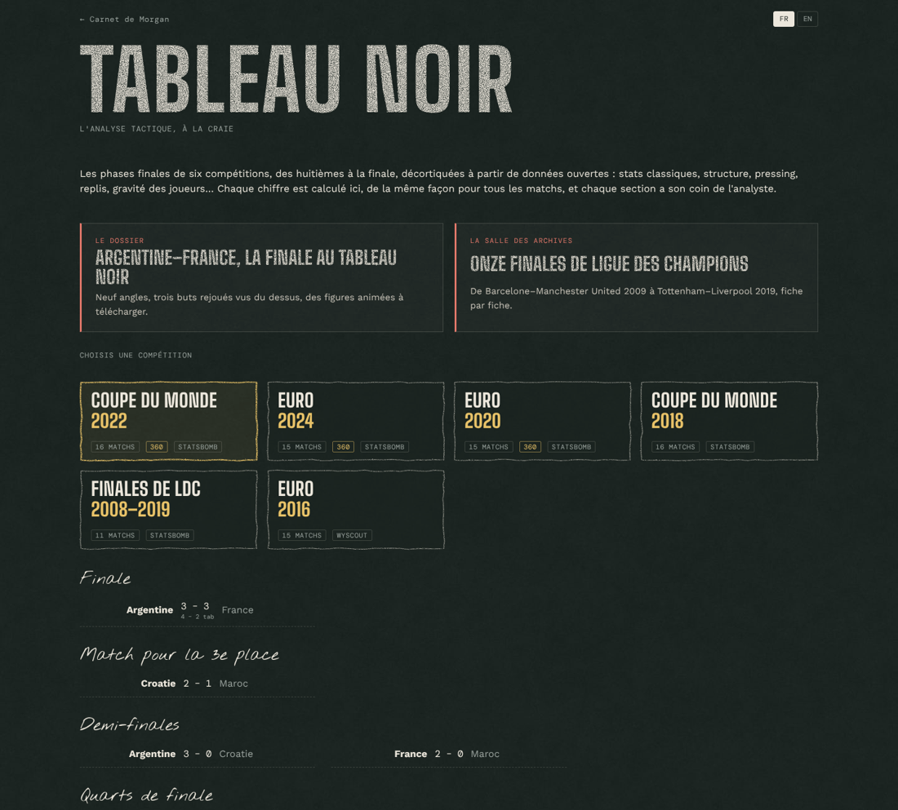

## Les données

| Source | Contenu utilisé | Conditions |
| --- | --- | --- |
| [Hudl StatsBomb Open Data](https://github.com/hudl/open-data) | Coupe du monde 2022, Euro 2024 et Euro 2020 (événements + 360), Coupe du monde 2018, finales de Ligue des champions 2008/09 → 2018/19 (événements) | Usage non commercial, pas de redistribution, logo StatsBomb sur toute analyse publiée |
| [Wyscout public dataset](https://figshare.com/collections/Soccer_match_event_dataset/4415000) (Pappalardo et al., 2019) | Euro 2016 (événements) ; les cinq grands championnats 2017/18 servent à entraîner le modèle d'xG | CC BY 4.0 |

Le détail des crédits est dans [`SOURCES.md`](SOURCES.md). **Les données brutes ne sont jamais versionnées** : StatsBomb est téléchargé (et mis en cache dans `data/raw/`) au moment du calcul, Wyscout est lu en local. Le site ne publie que des résultats calculés.

Tout est ramené à un **format commun** ([`model.py`](src/tableau_noir/model.py)) : un terrain de 105 × 68 m, chaque action vue depuis l'équipe qui la réalise (qui attaque vers la droite), un temps en secondes depuis le coup d'envoi. Les tirs au but ne comptent dans aucune statistique.

## Section 1 · Les stats classiques

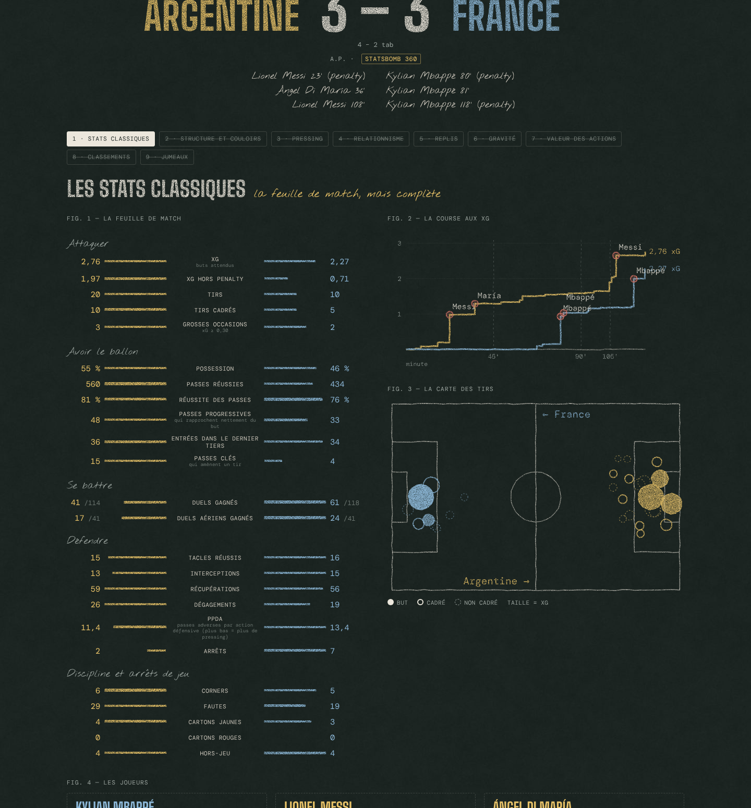

Pour chaque match ([`classic.py`](src/tableau_noir/classic.py)) :

- **la feuille de match**, équipe contre équipe : xG, tirs, grosses occasions (xG ≥ 0,30), possession, passes, passes progressives, entrées dans le dernier tiers, passes clés, duels, tacles, interceptions, récupérations, PPDA, corners, fautes, cartons, hors-jeu ;
- **la course aux xG**, minute par minute, avec les buts ;
- **la carte des tirs** (taille = xG ; plein = but, cercle plein = cadré, pointillé = non cadré) ;
- **les joueurs** : les trois hommes forts du match et un tableau triable.

Quelques définitions :

- **Possession au temps** : le ballon appartient à l'équipe en possession jusqu'à l'action suivante (10 s au plus).
- **Passe progressive** (définition Wyscout) : elle rapproche le ballon du but adverse d'au moins 30 m dans son camp, 15 m en franchissant la ligne médiane, 10 m dans le camp adverse.
- **PPDA** : passes adverses dans leurs 60 % de terrain, divisées par nos tacles, interceptions et fautes dans cette zone. Plus c'est bas, plus on presse.
- **xG** : celui de StatsBomb pour ses matchs. Wyscout n'en fournit pas : le modèle de Tableau Noir ([`xg.py`](src/tableau_noir/xg.py)) est une régression logistique sur 42 499 tirs des cinq grands championnats 2017/18 (distance, angle, tête, coup franc direct) ; un penalty vaut 0,73, le taux de réussite observé.

Contrôle : sur tous les matchs publiés, les buts recalculés à partir des événements (contre son camp compris) collent exactement au score. Sur la finale 2022, tirs et tirs cadrés (20 / 10 pour l'Argentine, 10 / 5 pour la France) collent aux chiffres officiels.

## Sections 2 à 5 · L'équipe

Calculées dans [`team.py`](src/tableau_noir/team.py). Chaque chiffre est comparé à la moyenne de la compétition (repère ⌀ sur les barres, qui vont du plus petit au plus grand match observé). Le **360** de StatsBomb (Coupe du monde 2022, Euro 2020, Euro 2024) ajoute la position des joueurs visibles à chaque action ; les autres matchs gardent les mesures tirées des événements, et le site le signale.

### 2 · Structure et couloirs

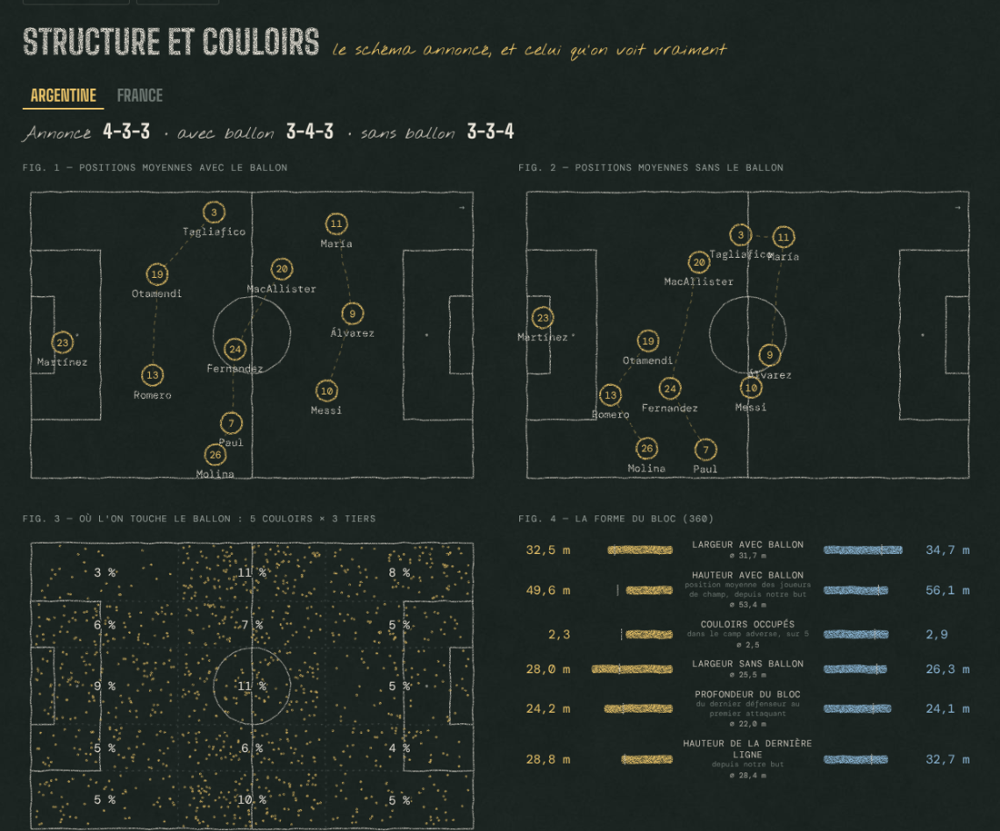

- **Positions moyennes** avec et sans le ballon, et la **formation réelle** qu'on en déduit : les joueurs de champ, triés de l'arrière vers l'avant, sont découpés en 3 ou 4 lignes (découpe optimale, ligne arrière de 3 à 5). Sur la finale 2022, l'Argentine annoncée en 4-3-3 joue en 3-4-3 avec le ballon.
- **Les 5 couloirs** (côté, demi-espace, axe) × 3 tiers : où l'équipe touche le ballon.
- **Le bloc** (360) : largeur, profondeur, hauteur de la dernière ligne, couloirs occupés dans le camp adverse.

### 3 · Pressing

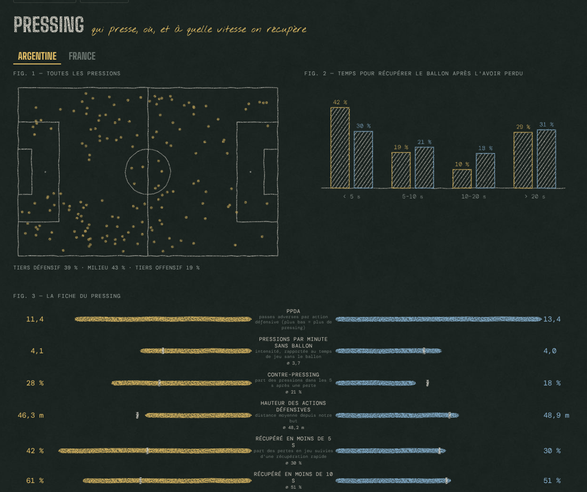

- La carte des pressions (Wyscout n'en a pas : tacles, interceptions et fautes à la place).
- **Temps de récupération** après chaque perte en jeu (passe ratée, contrôle manqué, dribble perdu, suivi d'une touche adverse) : moins de 5 s, 5–10, 10–20, au-delà.
- PPDA, pressions par minute sans ballon, contre-pressing, hauteur des actions défensives, récupérations hautes.

### 4 · Relationnisme

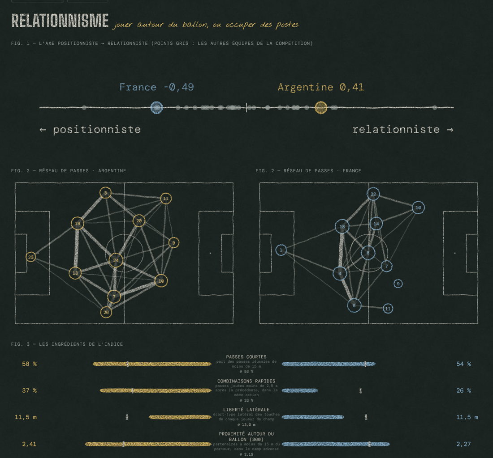

Un **axe positionniste ↔ relationniste** : moyenne des écarts réduits de cinq ingrédients face à la compétition (passes courtes, combinaisons rapides, liberté latérale, proximité autour du ballon, moins les couloirs occupés), avec toutes les équipes du tournoi en points gris. Plus les **réseaux de passes** des deux équipes.

### 5 · Replis

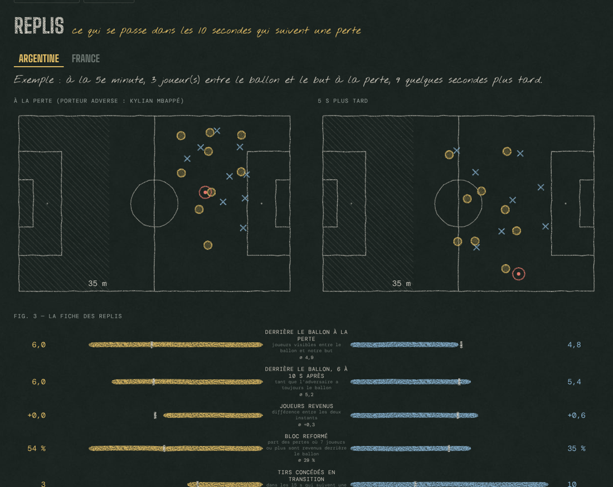

Après chaque perte : combien de joueurs sont entre le ballon et leur but au moment de la perte, puis 6 à 10 s plus tard (360), et les tirs concédés dans les 15 s (événements, pour tous les matchs). Deux images 360 montrent le repli le plus net du match. Le 360 ne voit que les joueurs dans le champ de la caméra : ces chiffres sont des minima.

## Sections 6 à 9 · Les joueurs

Calculées dans [`players.py`](src/tableau_noir/players.py) : d'abord match par match, puis sur toute la compétition, puis toutes compétitions confondues pour les jumeaux.

### 6 · Gravité

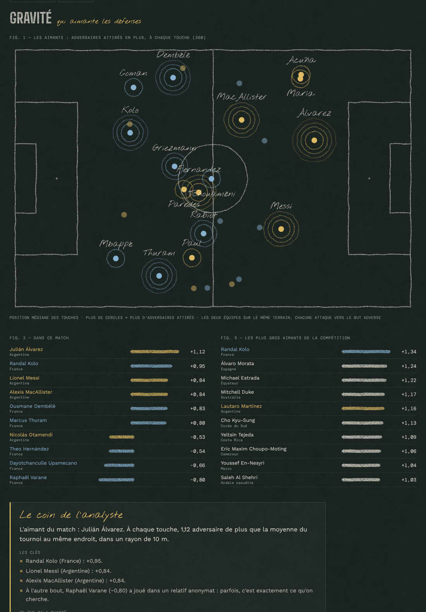

Qui aimante les défenses. Avec le 360 : à chaque touche de balle, le nombre d'adversaires à moins de 10 m, **moins la moyenne de la compétition au même endroit** (un milieu axial est toujours plus entouré qu'un latéral). Sans 360 : l'attention reçue, c'est-à-dire les actions défensives adverses à moins de 5 m et 2 s d'une touche, corrigées de la même façon.

### 7 · Valeur des actions (xT)

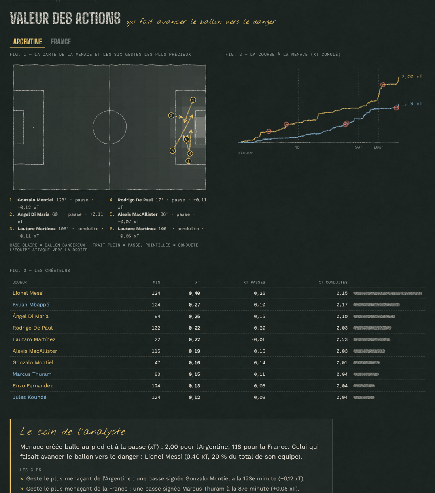

Un modèle d'**Expected Threat** maison ([`xt.py`](src/tableau_noir/xt.py), méthode de Karun Singh) : une grille de 16 × 12 cases calculée sur 1,8 million d'actions des cinq grands championnats 2017/18. Chaque passe ou conduite réussie vaut la menace qu'elle ajoute. Le site montre la carte de la menace, les six gestes les plus précieux de chaque équipe, la course à la menace minute par minute et les créateurs.

### 8 · Classements par poste

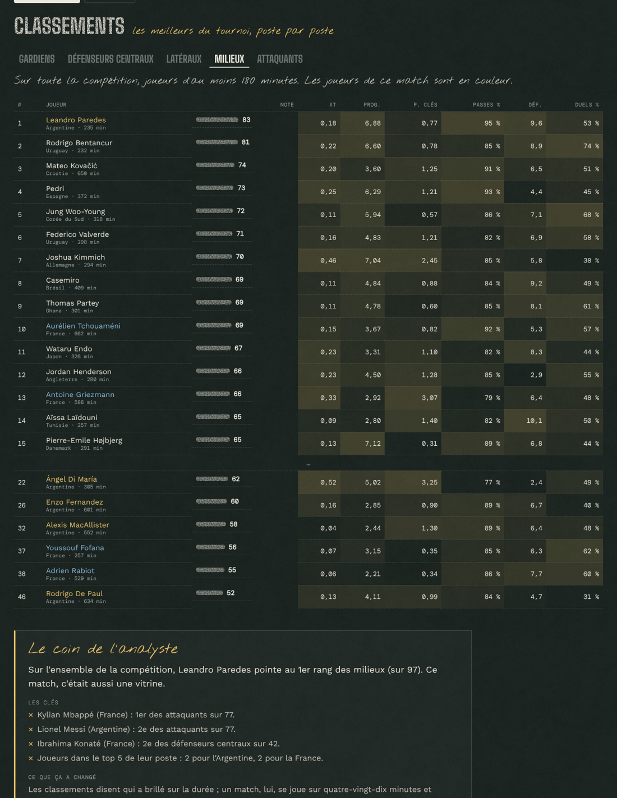

Par tournoi, pour les joueurs d'au moins 180 minutes (90 pour les finales de LDC) : gardiens, défenseurs centraux, latéraux, milieux, attaquants. Chaque indicateur par 90 minutes devient un centile parmi les joueurs du même poste ; la note est la moyenne des centiles du poste.

### 9 · Jumeaux

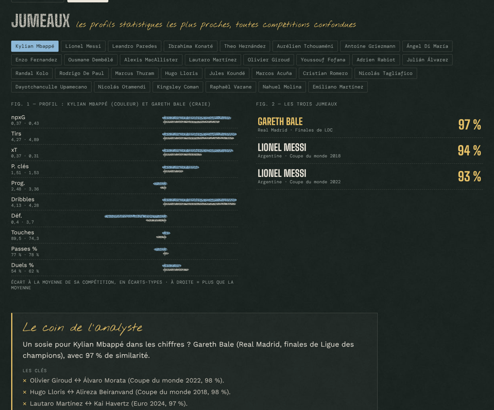

Un profil de dix indicateurs par 90 minutes, réduits dans sa compétition (ce qui gomme en partie les différences de comptage entre StatsBomb et Wyscout), puis les trois profils les plus proches au même poste, **toutes compétitions confondues**. Mbappé 2022 ressemble d'abord… à Gareth Bale en finale de Ligue des champions.

## Le coin de l'analyste

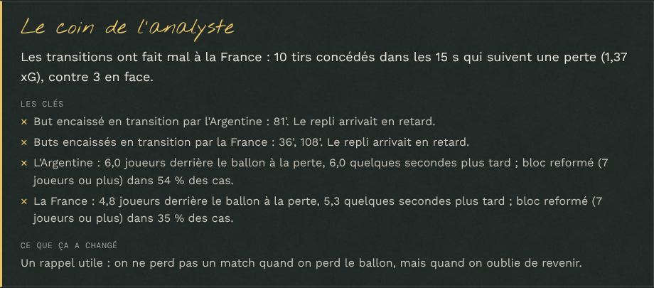

Le site ne garde que les **phases finales** : 88 matchs, des huitièmes à la finale, plus les onze finales de Ligue des champions. Les matchs de poules servent toujours aux calculs (moyennes de la compétition, classements, jumeaux), mais n'ont pas de page.

Pour chacun de ces 88 matchs et chacune des 9 sections, le coin de l'analyste est **écrit à la main**, en français et en anglais ([`data/notes/`](data/notes)) : une accroche, les clés, et ce que ça a changé dans le match. Chaque texte part d'une **fiche de faits** ([`facts.py`](src/tableau_noir/facts.py)) qui rassemble tout ce qui est publié sur le match ; `tableau-noir check-notes` vérifie que chaque nombre cité figure dans la fiche. Les noms d'équipe sont accordés à l'affichage (« l'Argentine », « du Portugal », « Argentina's »). Le générateur automatique ([`analyst.py`](src/tableau_noir/analyst.py)) reste en secours pour un match sans texte.

## Jalon 4 · Le dossier, les archives, les buts rejoués

### Le dossier Argentine–France

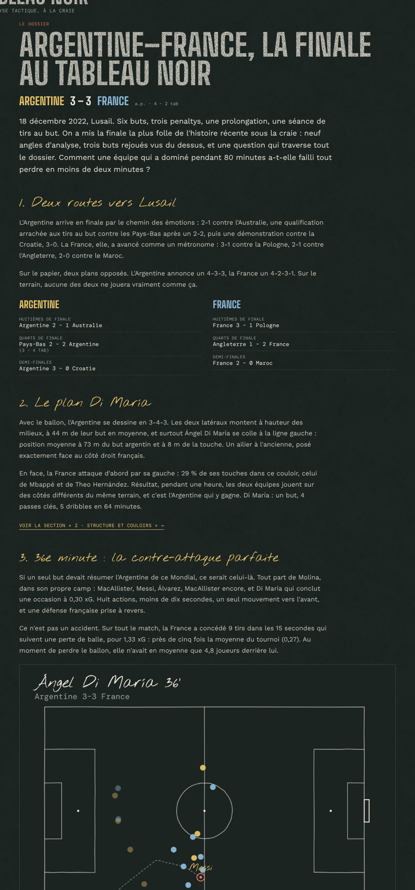

Un long format sur la finale 2022 ([`#/dossier`](https://mguillaudeux.github.io/tableau-noir/#/dossier)) : huit chapitres écrits à partir de la fiche du match ([`data/editorial/dossier-2022.py`](data/editorial/dossier-2022.py), vérifié par `tableau-noir dossier`), avec les trois buts du jeu rejoués, les courses aux xG et à la menace animées, et tout à télécharger en MP4 et en GIF.

### La salle des archives

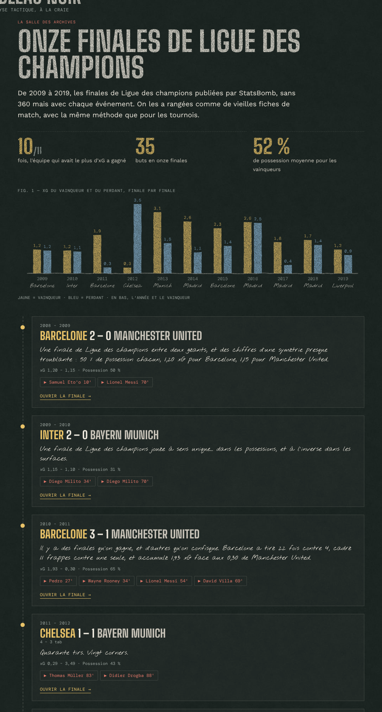

Les onze finales de Ligue des champions 2009–2019 rangées comme de vieilles fiches ([`#/archives`](https://mguillaudeux.github.io/tableau-noir/#/archives)) : xG du vainqueur et du perdant finale par finale, l'accroche de l'analyste, les buts rejoués, les buteurs et les créateurs de toutes les finales.

### Les buts rejoués, vus du dessus

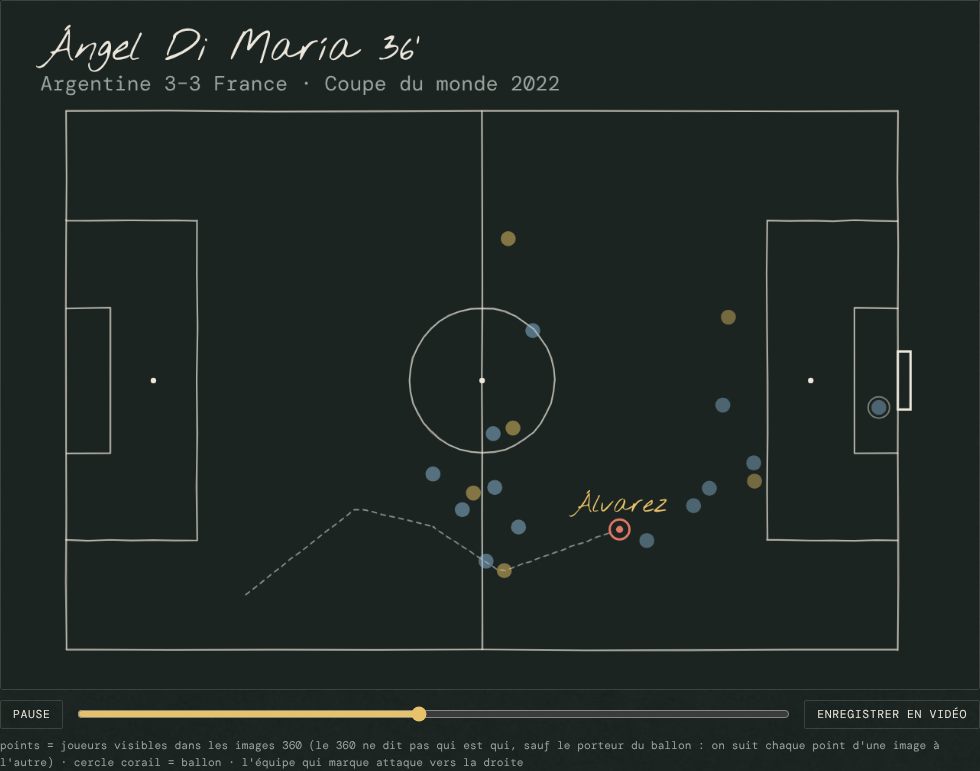

Pas d'images de match : chaque but est rejoué par des points sur un terrain ([`replay.py`](src/tableau_noir/replay.py), [`replay.js`](web/js/replay.js)). Le ballon suit les événements de l'action ; avec le 360, les joueurs visibles apparaissent à chaque événement, et on suit chaque point d'une image à l'autre (appariement par l'algorithme hongrois), puisque le 360 ne dit pas qui est qui. Bouton ▶ à côté de chaque buteur, et « Enregistrer en vidéo » dans le navigateur. La course aux xG de chaque match s'anime aussi (« ▶ animer », section 1).

Les MP4 et GIF du dossier sont produits par [`scripts/media.py`](scripts/media.py) : chaque image est dessinée dans `web/studio.html` à 25 images par seconde, puis assemblée par ffmpeg.

## La DA « Craie Exacte »

Une ardoise vert-noir, des traits de craie granuleux et doublés, quatre craies au sens fixe : **blanc = le terrain**, **jaune = l'équipe à domicile**, **bleu = l'équipe à l'extérieur**, **corail = l'alerte** (buts, cartons). Les titres sont étroits comme un panneau de stade, les annotations à la main, les chiffres en chasse fixe. [Planche](docs/da/planche-01.jpg), [intention](docs/da/craie-exacte.md).

## Lancer en local

```bash
just setup      # environnement (uv)
just xg         # modèle d'xG Wyscout (data/raw/wyscout requis)
just xt         # grille d'expected threat Wyscout
just export     # télécharge StatsBomb, calcule tout, écrit web/data/ (≈ 15 min)
uv run tableau-noir facts --out data/facts   # les fiches de faits, pour écrire
uv run tableau-noir check-notes             # vérifie les chiffres des textes
uv run tableau-noir dossier                 # vérifie et publie le dossier
uv run --with playwright python scripts/media.py   # MP4 et GIF du dossier (ffmpeg requis)
just serve      # le site : http://localhost:8000
just test       # tests Python et JavaScript
```

Pour Wyscout, déposer dans `data/raw/wyscout/` les fichiers de la collection figshare : `events/` (décompressé), `matches/` (décompressé), `players.json`, `teams.json`, `competitions.json`.

## Crédits

- Données : Hudl StatsBomb Open Data ; Wyscout, via L. Pappalardo et al., « A public data set of spatio-temporal match events in soccer competitions », *Scientific Data* 6, 236 (2019), CC BY 4.0.
- Polices (Google Fonts, licence SIL OFL) : Big Shoulders Display, Nothing You Could Do, DM Mono, Work Sans.
- Projet de passionné, pédagogique et non commercial. Aucun logo de club ni image de match.

Licence du code : MIT.
